<p align="center">
  
</p>

<p align="center">
  <a href="../../releases/latest"></a>
  <a href="../../releases"></a>
  
  <a href="LICENSE"></a>
  <a href="../../actions/workflows/build.yml"></a>
</p>

<p align="center">
  <b>Mandarine</b> est une petite application pour Windows qui travaille sur vos fichiers sans que vous ayez à ouvrir quoi que ce soit.<br>
  Sélectionnez un fichier, appuyez sur <kbd>Maj</kbd>, choisissez ce que vous voulez en faire : c'est fait, à côté de l'original.
</p>

<p align="center">
  <a href="#installation"><b>Installer</b></a> ·
  <a href="#ce-que-mandarine-sait-faire">Fonctionnalités</a> ·
  <a href="#questions-fréquentes">Questions fréquentes</a> ·
  <a href="../../releases">Versions</a>
</p>

<p align="center">
  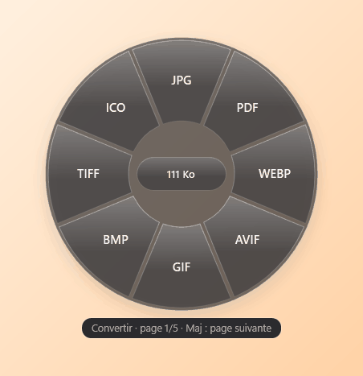
</p>

<p align="center"><sub>La roue des actions : huit actions par page, <kbd>Maj</kbd> pour tourner la page.</sub></p>

---

## En bref

| ⚡ Rapide | 🔒 Privé | 🎁 Gratuit |
| --- | --- | --- |
| Un geste, un choix, c'est converti. Mandarine reste discrète dans la zone de notification et ne consomme presque rien au repos. | Tout se passe sur votre PC. Aucun fichier n'est envoyé en ligne, pas de compte, pas de publicité. | Open source (licence MIT), sans limite d'usage ni abonnement. |

**Ce que vous pouvez faire sans installer d'autre logiciel :**
convertir des images, des PDF, des données et des archives · signer, caviarder, filigraner et réorganiser un PDF · recadrer, annoter, flouter et retoucher une photo · renommer en masse, trier un dossier et trouver les doublons · lire le texte d'une image (OCR).

## Sommaire

- [Installation](#installation)
- [Comment l'utiliser](#comment-lutiliser)
- [Ce que Mandarine sait faire](#ce-que-mandarine-sait-faire)
  - [Les images](#les-images) · [Les PDF](#les-pdf) · [Les fichiers et les dossiers](#les-fichiers-et-les-dossiers) · [Les outils de Windows](#les-outils-de-windows)
- [Tous les formats](#tous-les-formats)
- [Réglages](#réglages)
- [Vos fichiers restent chez vous](#vos-fichiers-restent-chez-vous)
- [Questions fréquentes](#questions-fréquentes)
- [Développement](#développement)
- [Feuille de route et licence](#feuille-de-route)

---

## Installation

1. Allez sur la page [**Releases**](../../releases/latest) et téléchargez **`MandarineApp-win-Setup.exe`**.
2. Lancez-le. Mandarine s'installe pour votre session (aucun droit administrateur) avec un raccourci dans le menu Démarrer.
3. Une petite bulle vous accueille et l'icône 🍊 apparaît dans la zone de notification. C'est prêt.

Vous préférez ne rien installer ? Le fichier **`Mandarine-win-x64.zip`** (ou `win-arm64` pour un PC ARM) contient juste `Mandarine.exe`, à lancer où vous voulez. Cette version-là ne se met pas à jour toute seule.

> **Windows affiche « Windows a protégé votre PC » ?** C'est normal : l'exécutable n'est pas signé numériquement (un certificat coûte cher). Cliquez sur **Informations complémentaires**, puis **Exécuter quand même**. Le code est entièrement public dans ce dépôt.

- **Aucun .NET à installer** : l'application est autonome.
- **Mises à jour automatiques** : une version installée cherche une nouvelle version 10 secondes après son lancement, la télécharge (une fenêtre montre l'avancement) et redémarre dedans.
- **Au premier lancement**, Mandarine s'ajoute au démarrage de Windows, au clic droit et à « Envoyer vers ». Tout se désactive dans les [réglages](#réglages).
- **Désinstaller** : depuis le menu de l'icône, ou « Applications installées » de Windows.

## Comment l'utiliser

Mandarine tourne discrètement dans la zone de notification. Il y a quatre façons d'ouvrir sa roue :

| | Comment | Pour qui |
| --- | --- | --- |
| 🖱️ **Le geste** | Commencez à **glisser** un fichier depuis l'Explorateur ou le Bureau, puis appuyez sur <kbd>Maj</kbd> : la roue apparaît sous le curseur. Relâchez le fichier sur le format voulu. | Pour les rapides |
| ⌨️ **Un appui sur Maj** | **Sélectionnez** des fichiers, puis tapez sur <kbd>Maj</kbd> **seule**. La roue s'ouvre centrée sur le fichier. Pas besoin de glisser. | Le plus simple |
| 🧾 **Le clic droit** | « **Convertir avec Mandarine** » dans le menu du clic droit (sous Windows 11 : « Afficher plus d'options »), ou « Envoyer vers › Mandarine ». | Pour une sélection multiple |
| ⚡ **Le raccourci** | Sélectionnez, puis <kbd>Ctrl</kbd>+<kbd>Maj</kbd>+<kbd>Espace</kbd> (modifiable). | Pour les claviers |

**Sur la roue :** survolez ou cliquez un secteur · <kbd>Maj</kbd> (ou un clic au centre) tourne la page · les touches <kbd>1</kbd> à <kbd>8</kbd> choisissent un secteur · <kbd>Échap</kbd> ou un clic ailleurs ferme la roue. Si vous préférez une liste à une roue, c'est dans les réglages.

### Et après ?

<p align="center">
  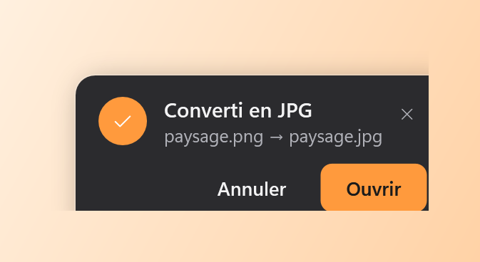
</p>

Une petite bulle en bas à droite dit **ce qui vient d'être fait**, avec deux boutons : **Ouvrir** le résultat, ou **Annuler** (le fichier créé part à la corbeille). Le menu de l'icône permet aussi d'annuler la dernière conversion.

**Votre fichier d'origine n'est jamais touché.** Les fichiers créés sont placés à côté de l'original (ou dans un dossier de votre choix) et un fichier existant n'est jamais écrasé : `photo.png` devient `photo (2).png`.

---

## Ce que Mandarine sait faire

### Les images

Convertissez entre **PNG, JPG, WebP, AVIF, GIF, BMP, TIFF, ICO, JXL, PDF**, et lisez aussi HEIC, PSD, SVG, RAW… Puis retouchez.

<table>
  <tr>
    <td align="center" width="50%">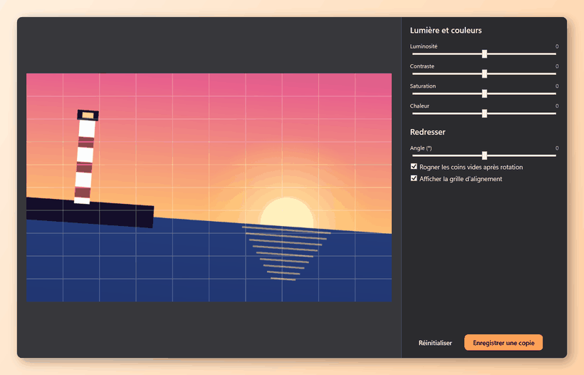<br><b>Redresser et retoucher</b><br><sub>Luminosité, contraste, couleurs, angle : l'aperçu se met à jour en direct.</sub></td>
    <td align="center" width="50%">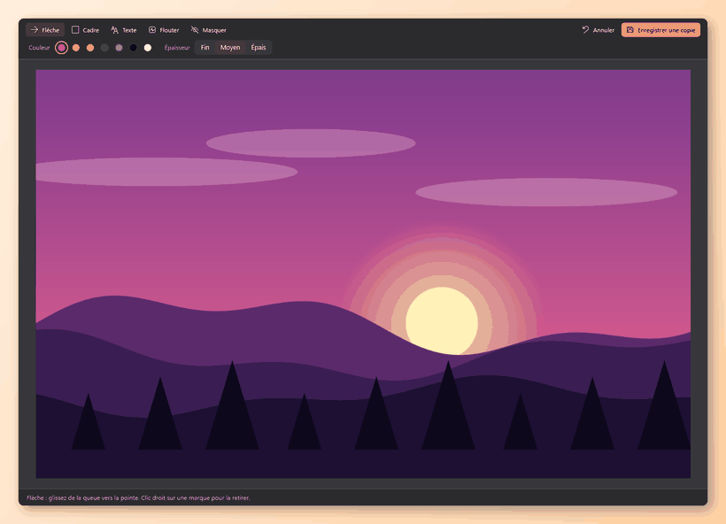<br><b>Annoter, flouter, masquer</b><br><sub>Flèches, cadres, texte, flou et zones noires.</sub></td>
  </tr>
</table>

<details>
<summary><b>Voir la liste des outils d'image</b></summary>

- **Recadrer** à la main avec des poignées, en libre ou en **1:1, 4:3, 3:4, 3:2, 2:3, 16:9, 9:16**.
- **Rogner automatiquement** les bords unis.
- **Annoter** : flèches, cadres, texte, 7 couleurs, 3 épaisseurs, annulation avec <kbd>Ctrl</kbd>+<kbd>Z</kbd>.
- **Flouter / masquer** une zone : la pixellisation est **définitive** dans la copie enregistrée (aucun flou à défaire).
- **Ajuster / redresser** : luminosité, contraste, saturation, chaleur, angle de −45° à +45° avec une grille d'alignement, et rognage des coins vides.
- **Réduire de 50 %**, **Max 1920 px**, **Compresser**, **Pivoter**, **Miroir**, **Noir et blanc**, **Icône 512 px** (pour un avatar), **Copier en Base64**.
- **Sans métadonnées** : retire EXIF (dont la position GPS), XMP et IPTC en gardant le profil couleur.

<p align="center">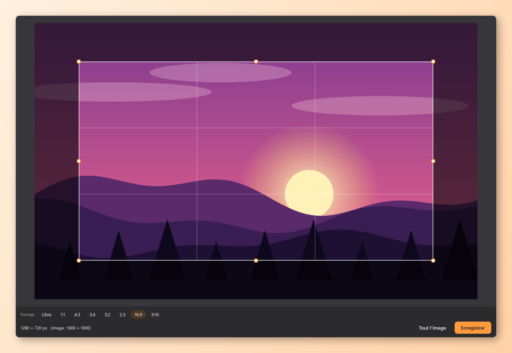</p>
</details>

### Les PDF

<table>
  <tr>
    <td align="center" width="50%">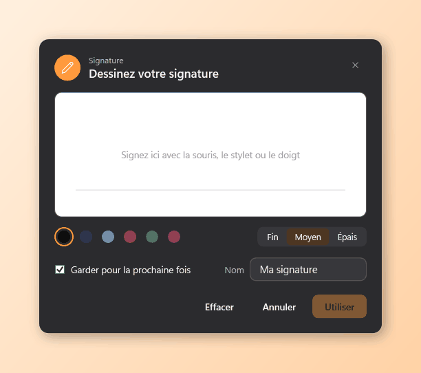<br><b>Signer</b><br><sub>Dessinez votre signature (ou ajoutez une image), posez-la sur la page. Elle est gardée pour la prochaine fois.</sub></td>
    <td align="center" width="50%">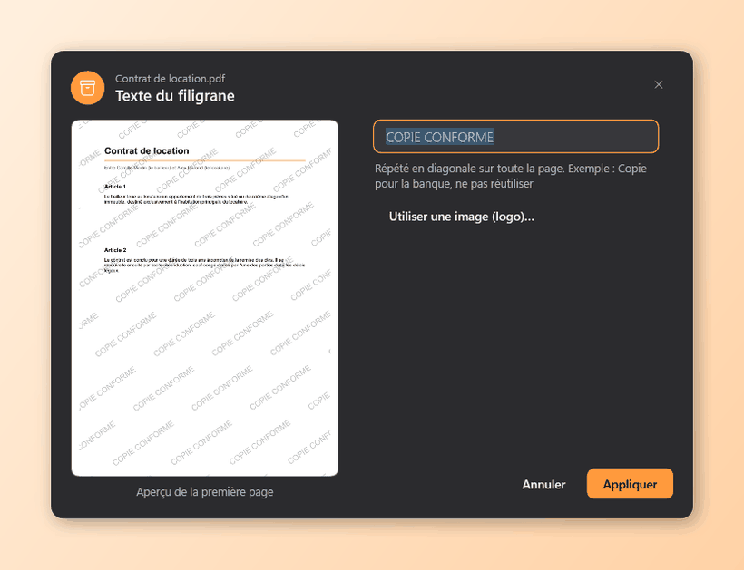<br><b>Filigrane avec aperçu</b><br><sub>Un texte ou un logo, répété en diagonale sur toute la page.</sub></td>
  </tr>
</table>

#### 🛡️ Caviarder : vraiment

<p align="center">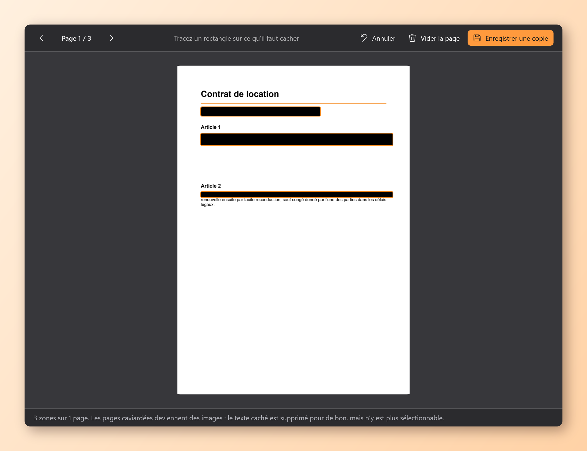</p>

Tracez des rectangles sur ce qui doit disparaître (nom, adresse, montant…). Mandarine reconstruit les pages concernées **à partir d'une image où le noir est déjà peint** : le texte caché n'existe plus dans le fichier, on ne peut ni le copier ni le retrouver. Les autres pages restent intactes. Une pièce d'identité à envoyer ? Caviardez, puis ajoutez un **filigrane**.

#### Tout le reste

<table>
  <tr>
    <td align="center" width="33%">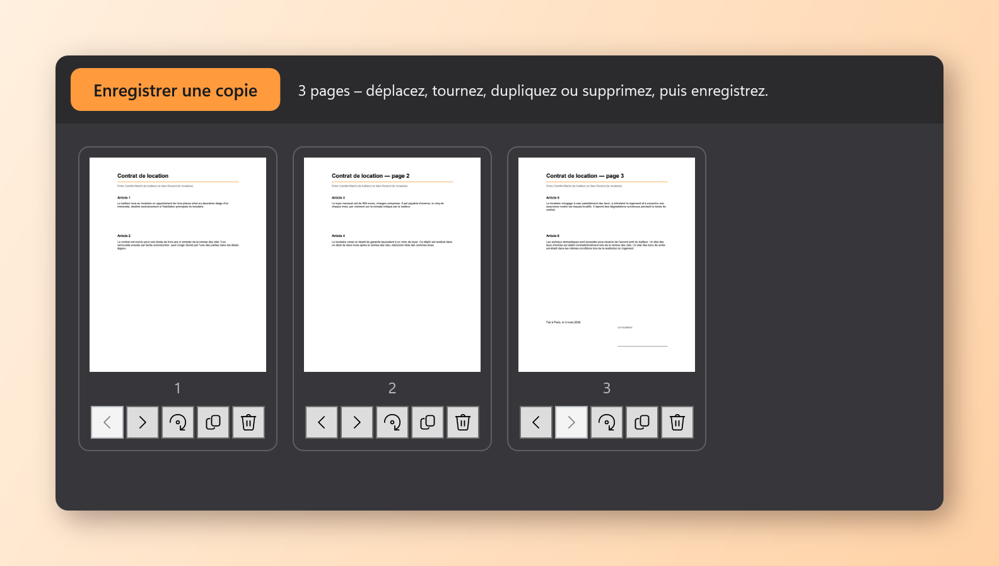<br><b>Réorganiser les pages</b><br><sub>Déplacer, tourner, dupliquer, supprimer.</sub></td>
    <td align="center" width="33%">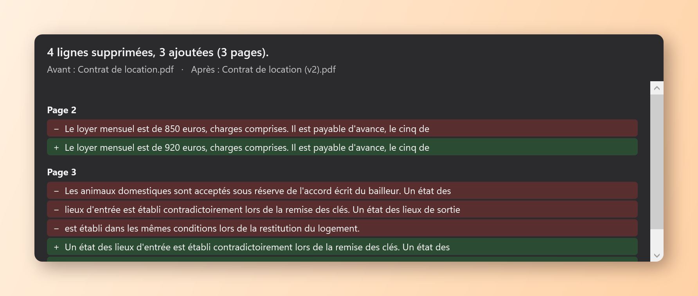<br><b>Comparer deux versions</b><br><sub>Lignes ajoutées en vert, supprimées en rouge.</sub></td>
    <td align="center" width="33%">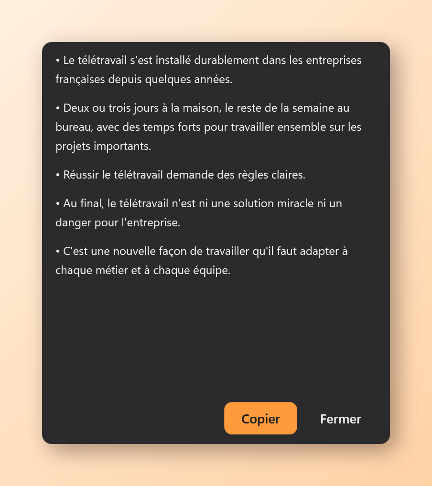<br><b>Résumer</b><br><sub>Les phrases clés, calculées sur votre PC, sans service en ligne.</sub></td>
  </tr>
  <tr>
    <td align="center">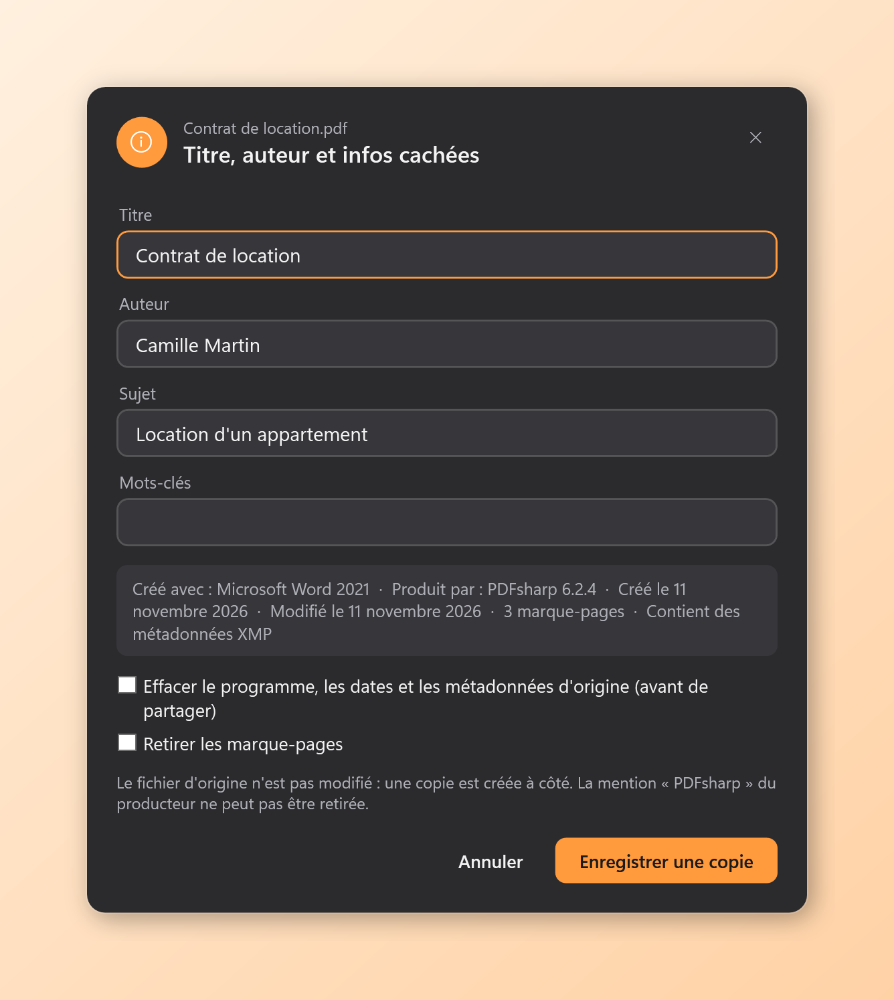<br><b>Métadonnées</b><br><sub>Titre, auteur, et effacer les infos cachées avant de partager.</sub></td>
    <td align="center">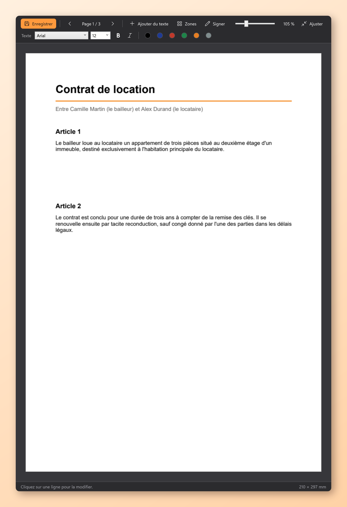<br><b>Modifier le texte</b><br><sub>Cliquez une ligne et tapez. Ajoutez du texte, signez.</sub></td>
    <td align="center">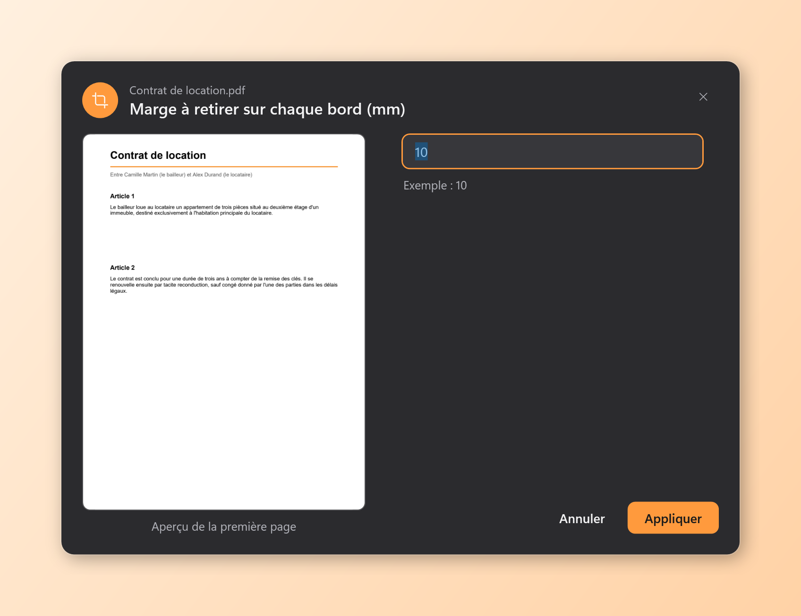<br><b>Recadrer avec aperçu</b><br><sub>Retirer une marge sur chaque bord.</sub></td>
  </tr>
</table>

<details>
<summary><b>Voir la liste des outils PDF</b></summary>

- **Convertir** en PNG ou JPG (une image par page) ou en TXT.
- **Fusionner** plusieurs PDF et images en un seul (premier secteur de la roue, dans l'ordre des noms).
- **Une page par fichier**, **Pivoter les pages**.
- **Supprimer** ou **extraire** des pages (`2, 4-6, 9-`), **réorganiser** sur une planche de vignettes, **numéroter**.
- **Filigrane** texte ou logo, **Recadrer**, **Extraire les images**.
- **Protéger** par mot de passe, **retirer le mot de passe**.
- **Comparer** deux PDF (sélectionnez-les ensemble), **Résumer**, **Métadonnées**.
</details>

### Les fichiers et les dossiers

<table>
  <tr>
    <td align="center" width="50%">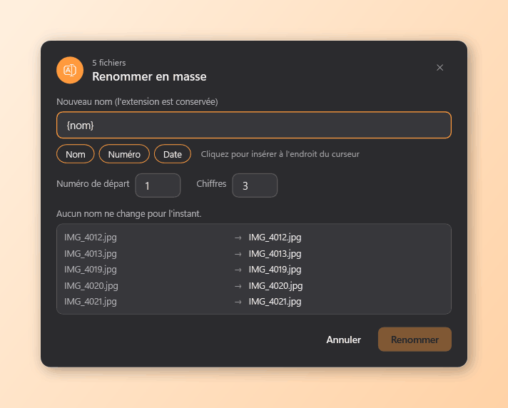<br><b>Renommer en masse</b><br><sub>Un modèle avec <code>{nom}</code>, <code>{n}</code> et <code>{date}</code>. La liste des nouveaux noms s'affiche avant d'appliquer, et vous pouvez annuler.</sub></td>
    <td align="center" width="50%">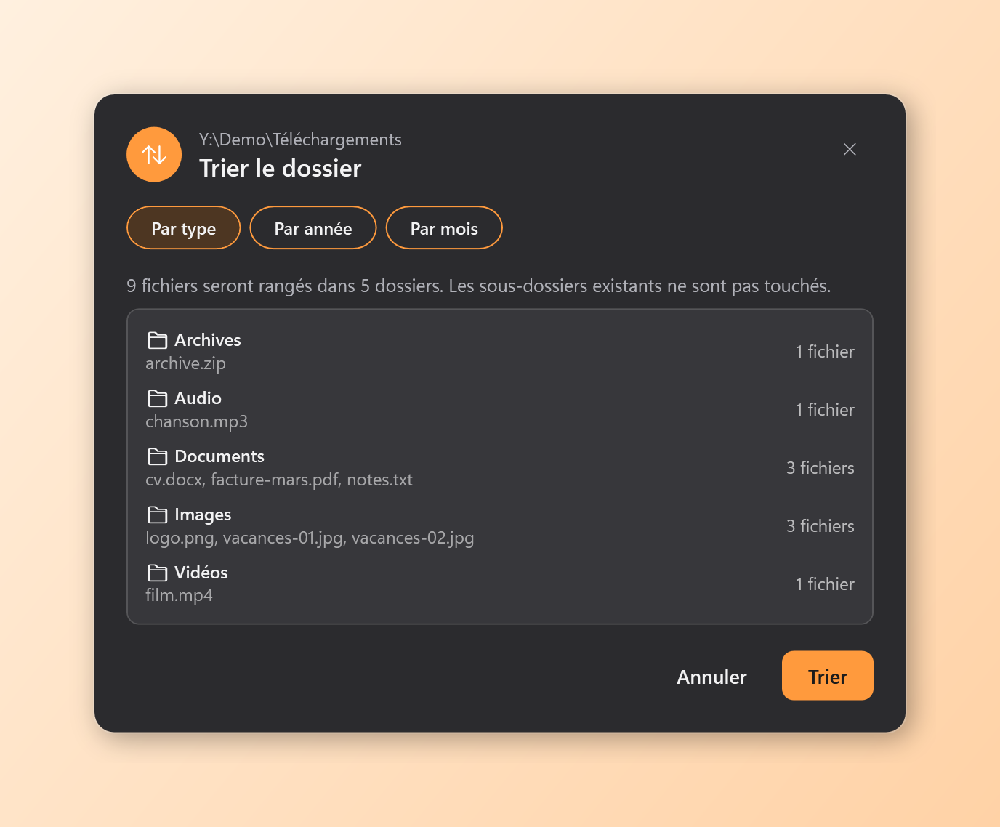<br><b>Trier un dossier</b><br><sub>Par type, par année ou par mois, avec un bouton pour tout remettre.</sub></td>
  </tr>
  <tr>
    <td align="center">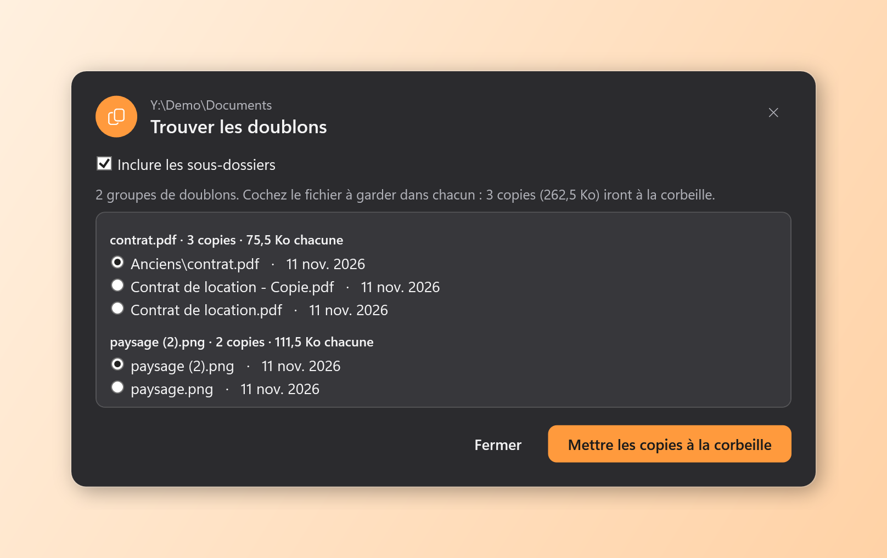<br><b>Trouver les doublons</b><br><sub>Les copies identiques (même contenu, pas seulement même nom). Vous choisissez celle à garder, les autres vont à la corbeille.</sub></td>
    <td align="left" valign="middle">
      <b>Aussi, pour n'importe quel fichier ou dossier :</b>
      <ul>
        <li><b>Compresser en ZIP</b></li>
        <li><b>Extraire</b> une archive (ZIP, TAR, GZ, 7Z, RAR)</li>
        <li><b>Copier le chemin</b></li>
        <li><b>Empreinte SHA-256</b></li>
      </ul>
    </td>
  </tr>
</table>

### Les outils de Windows

Mandarine s'appuie sur ce que Windows sait déjà faire : **Extraire le texte (OCR)** d'une image ou d'un PDF scanné, **Copier le texte**, **Copier l'image**, **Mettre en fond d'écran**, **Imprimer**. Le texte est reconnu par Windows, sur votre PC.

### Données et texte

Convertissez **JSON ↔ YAML ↔ XML ↔ CSV/TSV** et **Markdown ↔ HTML**. Un CSV exporté d'Excel en français (séparateur `;`) est reconnu tout seul, et `06000` reste du texte dans un JSON.

---

## Tous les formats

| Fichier | Convertir en | Outils |
| --- | --- | --- |
| **Image** (PNG, JPG, HEIC, WebP, AVIF, GIF, BMP, TIFF, PSD, SVG, JXL, RAW…) | PNG, JPG, PDF, WEBP, AVIF, GIF, BMP, TIFF, ICO, JXL | Réduire, Compresser, Sans métadonnées, Pivoter, Miroir, Noir et blanc, Rogner automatiquement, Recadrer, Annoter, Flouter / masquer, Ajuster / redresser, Copier en Base64 |
| **PDF** | PNG, JPG (une image par page), TXT | Une page par fichier, Pivoter, Modifier le texte, Signer, Supprimer / extraire / réorganiser des pages, Numéroter, Filigrane, Recadrer, Extraire les images, Caviarder, Résumer, Comparer, Métadonnées, Protéger / déverrouiller |
| Markdown / HTML | HTML / Markdown | |
| JSON | YAML, CSV, XML | |
| YAML, XML | JSON | |
| CSV, TSV | JSON, CSV ↔ TSV | |
| Archive (ZIP, TAR, TAR.GZ, GZ, 7Z, RAR) | | Extraire |
| Plusieurs images et/ou PDF | **Fusionner en PDF** | |
| Image ou PDF | | Extraire le texte (OCR), Copier le texte, Copier l'image, Fond d'écran, Imprimer |
| Plusieurs fichiers | | Renommer en masse |
| Dossier | | Trier, Trouver les doublons |
| Tout fichier ou dossier | | Compresser en ZIP, Copier le chemin, Empreinte SHA-256 |

Quelques choix faits pour éviter les mauvaises surprises :

- les photos sont **redressées selon leur orientation EXIF** avant toute opération ;
- les formats sans transparence (JPG, BMP) reçoivent un **fond blanc** au lieu de noir ;
- tout est fait par Mandarine elle-même : **rien d'autre à installer**. L'audio, la vidéo et les documents Office (qui demandent FFmpeg ou LibreOffice) sont mis de côté dans cette version.

---

## Réglages

Icône de la zone de notification (clic gauche ou droit) › **Paramètres**. **Chaque changement est enregistré et appliqué tout de suite**, sans bouton à valider.

<p align="center">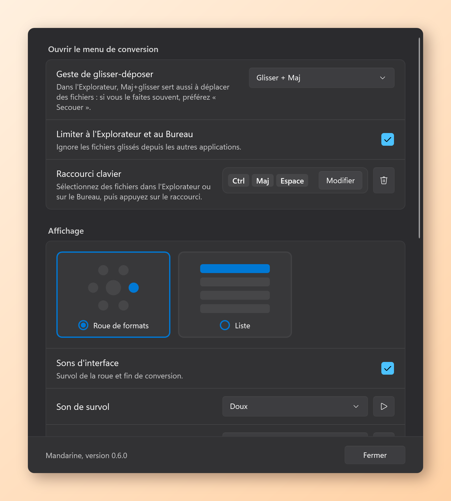</p>

- **Ouvrir le menu de conversion** : glisser + <kbd>Maj</kbd>, <kbd>Alt</kbd> ou <kbd>Ctrl</kbd> ; **appuyer sur <kbd>Maj</kbd>** sans glisser ; **secouer le fichier** (trois allers-retours rapides) ; ou désactivé. Dans l'Explorateur, <kbd>Maj</kbd>+glisser sert aussi à *déplacer* des fichiers : si c'est un réflexe pour vous, préférez « Appuyer sur Maj » ou « Secouer ».
- **Limiter à l'Explorateur et au Bureau** : ignore les fichiers glissés depuis d'autres applications (activé par défaut).
- **Raccourci clavier** : cliquez sur « Modifier » puis tapez la combinaison. <kbd>Échap</kbd> annule, la corbeille supprime le raccourci.
- **Affichage** : roue de formats ou liste. **Sons** : un son de survol et un de fin de conversion (*Doux*, *Verre*, *Goutte*, *Soie* ou *Aucun*), synthétisés par Mandarine.
- **Fichiers créés** : à côté de l'original ou dans un dossier fixe ; **qualité** JPEG/WebP/AVIF.
- **Windows** : lancement à l'ouverture de session (discret), intégration au clic droit et à « Envoyer vers ».

## Vos fichiers restent chez vous

- Les conversions, les retouches, le caviardage, le résumé et l'OCR se font **sur votre PC**. Aucun fichier n'est envoyé.
- Pas de compte, pas de télémétrie, pas de publicité.
- Mandarine ne se connecte à Internet que pour **chercher une mise à jour** et pour la page « Nouveautés » (les deux interrogent GitHub), et pour installer FFmpeg ou LibreOffice **si vous le demandez**.
- Le raccourci et le geste lisent des **codes de touches**, jamais le texte que vous tapez, et ne bloquent aucune touche.
- Le journal d'erreurs (`%LOCALAPPDATA%\Mandarine\errors.log`) ne contient que des erreurs techniques : ni contenu de fichiers, ni frappes.

## Questions fréquentes

<details>
<summary><b>Mes fichiers d'origine sont-ils modifiés ?</b></summary>

Non. Chaque résultat est un **nouveau fichier** à côté de l'original, avec un nom qui dit ce qu'il est (`photo - recadrée.jpg`, `contrat - caviardé.pdf`). Deux exceptions que vous déclenchez vous-même : l'éditeur de PDF qui enregistre dans le fichier ouvert, et « Renommer en masse » (annulable).
</details>

<details>
<summary><b>Comment annuler ?</b></summary>

Après une conversion : le bouton **Annuler** de la bulle, ou « Annuler la dernière conversion » dans le menu de l'icône. Le renommage en masse et le tri de dossier ont leur propre bouton d'annulation dans leur fenêtre. Les fichiers supprimés vont à la **corbeille**, jamais effacés pour de bon.
</details>

<details>
<summary><b>Le geste Maj + glisser déplace mes fichiers dans l'Explorateur !</b></summary>

Dans l'Explorateur, <kbd>Maj</kbd> pendant un glisser veut dire « déplacer ». Mandarine copie toujours (jamais de déplacement), mais si c'est un réflexe gênant, choisissez dans les réglages **« Appuyer sur Maj »** (sans glisser) ou **« Secouer »**.
</details>

<details>
<summary><b>Je ne vois pas « Convertir avec Mandarine » dans le clic droit</b></summary>

Sous Windows 11, cliquez sur **« Afficher plus d'options »** en bas du menu. Vous pouvez aussi utiliser « Envoyer vers › Mandarine », ou simplement sélectionner puis appuyer sur <kbd>Maj</kbd>.
</details>

<details>
<summary><b>Pourquoi pas de sortie HEIC, de vidéo ou de documents Word ?</b></summary>

La lecture HEIC fonctionne, mais l'écriture est soumise à des brevets (encodeur HEVC). L'audio, la vidéo et les documents Office demandent FFmpeg ou LibreOffice : ils sont volontairement laissés de côté dans cette version pour que Mandarine fonctionne sans rien installer à côté.
</details>

<details>
<summary><b>Le caviardage est-il vraiment sûr ?</b></summary>

Oui pour ce qu'il promet : les pages caviardées sont **recréées à partir d'une image** où le noir est peint, donc le texte dessous n'existe plus (un test automatique le vérifie). Contrepartie : ces pages deviennent des images, leur texte n'est plus sélectionnable. Les pages sans zone noire ne changent pas.
</details>

<details>
<summary><b>Comment désinstaller ?</b></summary>

Menu de l'icône › **Désinstaller Mandarine**, ou « Applications installées » dans les paramètres de Windows. Cela retire aussi le clic droit et le démarrage automatique.
</details>

---

## Développement

Prérequis : [.NET 10 SDK](https://dotnet.microsoft.com/download). Le moteur se compile et se teste sur Windows, macOS et Linux ; l'application ne s'exécute que sur Windows.

```
src/
  Mandarine.Core/    moteur de conversion, multiplateforme, sans interface
    Actions/         FileAction, catalogue, contexte, résultats
    Converters/      images (Magick.NET), PDF (PDFsharp, PDFtoImage, PdfPig), audio/vidéo (FFmpeg),
                     Office (LibreOffice), Markdown/HTML, données, archives
    Infrastructure/  noms de sortie, renommage en masse, tri, doublons…
  Mandarine.App/     application WPF : hooks souris et clavier, roue, zone de notification, fenêtres d'outils
tests/
  Mandarine.Core.Tests/   tests xUnit ; ceux qui demandent FFmpeg ou LibreOffice sont ignorés s'ils sont absents
tools/
  Mandarine.Shots/        génère les captures et les animations de ce README (voir plus bas)
scripts/                  assemblage des GIF, bannière, descriptions des releases
docs/                     images du README et descriptions des releases
```

```powershell
dotnet test                                   # tests du moteur
dotnet run --project src/Mandarine.App        # lancer l'application (Windows)
dotnet publish src/Mandarine.App -c Release -r win-x64 --self-contained `
  -p:PublishSingleFile=true -p:IncludeNativeLibrariesForSelfExtract=true
```

`.\run.ps1` recompile l'application dans `publish\` et la relance depuis là : le menu Démarrer, le clic droit et le lancement au démarrage utilisent alors toujours la dernière version du code.

**Ajouter une conversion** revient à écrire une classe dérivée de `PerFileAction` (un fichier en entrée, un fichier en sortie) ou de `FileAction`, puis à l'enregistrer dans `ActionCatalog`. La roue l'affiche automatiquement pour les fichiers qu'elle accepte. Une action qui a besoin d'une saisie déclare un `Prompt` ; une action qui ouvre sa propre fenêtre tourne dans un process séparé (pdfium reste hors de l'application résidente).

**Versions et releases.** La CI compile, teste et publie à chaque push. Pousser un tag `v*` crée une release avec les archives, l'installateur `MandarineApp-win-Setup.exe` et les fichiers de mise à jour. Le numéro est celui du tag. La description de la release vient de `docs/releases/vX.Y.Z.md`, générée par `python scripts/release-notes.py` à partir de la page « Nouveautés » de l'application.

**Les images de ce README** sont produites par l'application elle-même : `tools/Mandarine.Shots` affiche ses fenêtres hors de l'écran, sans souris ni bureau dans l'image, et enregistre les captures et les images des animations ; `scripts/make-gifs.py` assemble les GIF.

```powershell
dotnet run --project tools/Mandarine.Shots -c Release -- docs/images
python scripts/make-gifs.py "$env:TEMP\mandarine-shots\frames" docs/images
python scripts/make-banner.py
```

<details>
<summary><b>Comment marche le geste</b></summary>

Un hook souris bas niveau (`WH_MOUSE_LL`, sur un thread dédié pour ne jamais ralentir le curseur) repère un glisser qui démarre dans l'Explorateur avec la touche choisie enfoncée. Pendant le glisser, une courte surveillance (30 ms, seulement une fois la souris bougée) détecte une touche pressée sans que la souris bouge. Mandarine ouvre alors sous le curseur une fenêtre quasi transparente, enregistrée comme cible de dépôt OLE. Dès qu'un fichier la survole, elle lit la liste des fichiers glissés, affiche les formats compatibles et devient visible. Si le bouton est relâché ailleurs, elle se referme.

Un hook clavier bas niveau (`WH_KEYBOARD_LL`, également sur son propre thread) ne lit que des codes de touches, jamais le texte, et ne bloque aucune touche. Il sert à l'appui sur <kbd>Maj</kbd> seul (appuyé et relâché en moins de 0,4 s, sans autre touche ni clic), à tourner les pages et à fermer la roue avec <kbd>Échap</kbd> quand elle est ouverte pendant un glisser et n'a donc pas le focus.

Pour centrer la roue sur le fichier, la position de l'icône est lue par UI Automation dans l'Explorateur, ou par les messages de la liste d'icônes du Bureau. Cette recherche se fait hors du thread de l'interface et est limitée à une demi-seconde : au-delà, la roue s'ouvre sous la souris.
</details>

<details>
<summary><b>Performances et taille</b></summary>

Au repos, Mandarine occupe une dizaine de Mo de mémoire de travail et 0 % de processeur ; elle démarre en moins d'une seconde. L'exécutable autonome pèse environ 213 Mo (le runtime .NET, WPF, Magick.NET, pdfium et Skia) ; l'installeur fait 98 Mo. Les anciennes copies de bibliothèques que .NET décompresse dans `%TEMP%\.net` à chaque version sont nettoyées automatiquement.
</details>

## Feuille de route

Version 0.6. Le moteur est couvert par plus de 90 tests automatisés (certains sont ignorés si FFmpeg ou LibreOffice sont absents). L'interface Windows est compilée et empaquetée par la CI, mais doit encore être éprouvée sur davantage de configurations (multi-écrans à échelles différentes, Windows 10, ARM).

Pistes :

- compression PDF, suppression d'arrière-plan ;
- progression dans la zone de notification pour les longues vidéos ;
- entrée dans le menu contextuel moderne de Windows 11 (nécessite un paquet MSIX signé) ;
- traduction anglaise.

Une idée, un défaut ? [Ouvrez une issue](../../issues).

## Licence

[MIT](LICENSE).

Bibliothèques : [Magick.NET](https://github.com/dlemstra/Magick.NET) (Apache 2.0), [PDFsharp](https://www.pdfsharp.com/) (MIT, version 6.2), [PDFtoImage](https://github.com/sungaila/PDFtoImage) (MIT), [PdfPig](https://github.com/UglyToad/PdfPig) (Apache 2.0), [Markdig](https://github.com/xoofx/markdig) (BSD-2), [ReverseMarkdown](https://github.com/mysticmind/reversemarkdown-net) (MIT), [YamlDotNet](https://github.com/aaubry/YamlDotNet) (MIT), [Velopack](https://velopack.io/) (MIT). FFmpeg et LibreOffice ne sont pas redistribués : ils sont installés séparément par l'utilisateur.
